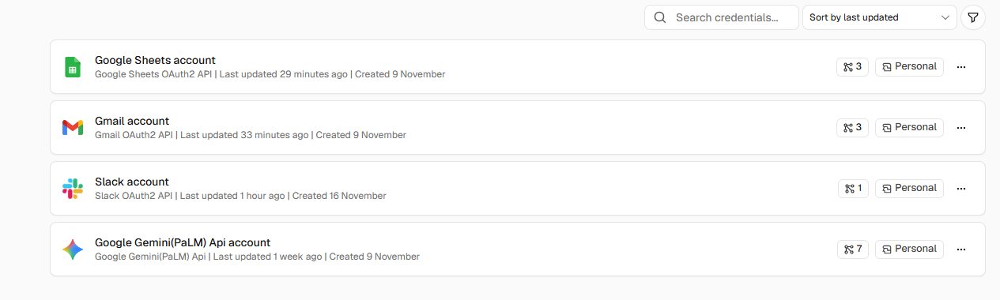

# Manager de Operaciones Comerciales

Workflow en n8n para gestionar comunicaciones comerciales entrantes mediante agentes de IA, memoria persistente e integraciones con herramientas de trabajo.

## Funcionamiento

1. Gmail detecta un correo recibido y un filtro descarta respuestas automáticas.
2. El Manager clasifica la solicitud y el Worker redacta una respuesta comercial utilizando el contexto disponible.
3. Google Sheets consulta el registro de contactos antes de crear uno nuevo, evitando duplicados.
4. Gmail guarda la respuesta como borrador para revisión humana, sin enviarla automáticamente.
5. Google Sheets actualiza la memoria de la conversación y Slack informa al equipo sobre el borrador pendiente.

## Integraciones

- **Gmail:** recepción de mensajes y creación de borradores.
- **Google Sheets:** pestañas `Contactos` y `Memoria` para registrar contactos y conservar contexto.
- **Slack:** notificaciones en el canal `#operaciones-comerciales`.
- **Google Gemini:** clasificación y redacción de las respuestas.

Las integraciones se configuran en n8n mediante credenciales propias. El archivo JSON no contiene contraseñas ni tokens de acceso.

## Credenciales en n8n

La siguiente captura muestra las credenciales configuradas para Gmail, Google Sheets y Slack en el entorno utilizado.

## Importación

1. Importar `checkpoint4_roberto_zelaya.json` en n8n.
2. Vincular las credenciales correspondientes a Gmail, Google Sheets, Slack y Gemini.
3. Comprobar el documento de Google Sheets, las pestañas `Contactos` y `Memoria`, y el canal de Slack.
4. Ejecutar una prueba controlada antes de activar el workflow.
